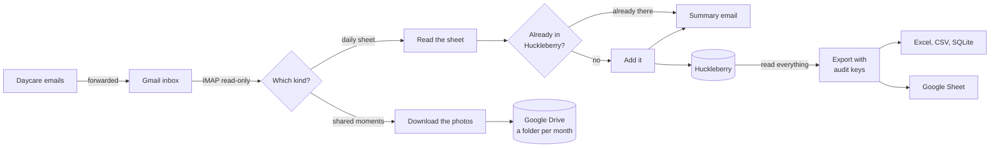

# MillieBeanCounter

Daycare emails in. Baby tracker entries and a photo album out.

MillieBeanCounter reads the emails that daycares send through Kaymbu (built and tested
with a Goddard School classroom's emails) and does two things with them:

* **Daily sheets.** Every bottle, nap and diaper goes into the Huckleberry baby tracker
  app.
* **Photos.** The "Shared Moments" photos are saved to Google Drive, one folder per
  month, each named with the date, your child's name and age:
  `October 2026/10/14 Josie 4m 11d Photo 1.jpg`.

It also keeps a complete, auditable copy of everything in Huckleberry as an Excel
workbook, CSV files, a SQLite database and, optionally, a Google Sheet, ready for pandas
or SQL.

It runs in Docker, checks Gmail every 15 minutes, and emails you a short summary after
each sheet it logs.

## Why

The daycare's daily sheet lists every bottle, nap and diaper with times. Huckleberry is
where the rest of the day gets tracked. Copying one into the other by hand every
evening is slow, and it's easy to end up a few minutes or an ounce off. The photos come
one email at a time and end up buried in the inbox.

The first version of this project drove the Huckleberry Android app in an emulator and
read the screen with OCR. This version skips all of that and talks to Huckleberry
directly through [py-huckleberry-api](https://github.com/Woyken/py-huckleberry-api),
an unofficial, reverse-engineered client.

## How it works



1. Every 15 minutes it looks for new emails in a Gmail inbox, opened read-only. Only
   senders you allow count.
2. **Daily sheets:** it reads the bottles, diapers and naps from both the HTML and
   plain-text versions of the email and checks that the two agree. The date comes from
   the sheet itself, not from when the email was sent or forwarded. It compares each
   entry with what Huckleberry already has, so nothing you entered by hand gets
   doubled, adds the rest, records everything in a local journal, and emails a summary.
3. **Photos:** it downloads each moment's photo and uploads it into Google Drive, into
   the folder for that month.
4. After each import, and at least once a day, it reads everything in Huckleberry
   (every tracker, whoever entered it) and refreshes the data export.

Built with Python 3.14 in Docker, SQLite, openpyxl, the Google Drive and Sheets APIs
and py-huckleberry-api.

## Design choices

* **Never guess.** A line on the sheet in a wording it hasn't seen is reported in the
  summary, not logged.
* **Never overwrite.** It only adds entries. Nothing in Huckleberry is ever edited or
  deleted. When Huckleberry and the sheet disagree (wet vs. BM, 4 oz vs. 5 oz), the
  summary says so and a person decides.
* **Safe to run again.** Every email, entry and photo is journaled. A diaper or bottle
  already in Huckleberry within 15 minutes of the sheet's time, or a nap that overlaps,
  counts as already there. Matching is one-to-one, so a single hand-entered diaper
  can't hide two daycare diapers. A crash partway through is retried without
  duplicates, in Huckleberry and in Google Drive.
* **Auditable.** Every entry gets a permanent key. Every entry the sync adds can be
  traced back to the email it came from, and the export can be checked field by field
  against Huckleberry's own CSV export.
* **Private by default.** Passwords live only in a Docker volume, never in this folder.
  Gmail is opened read-only. Google Drive access is limited to the files this app
  creates. The container runs as a non-root user with a read-only filesystem and no
  extra privileges. The tests use made-up emails.
* **Problems get reported once.** A problem is emailed at most once a day. A failed
  data export or photo upload never stops the Huckleberry side.

## What it reads

| In the email | Where it goes |
| --- | --- |
| "Offered 4.5 ounces of breastmilk and took 4 ounces at 10:30am" | Huckleberry: a 4 oz breast milk bottle at 10:30 AM (formula and ml work too) |
| "Wet", "BM", "BM/Wet" or "Dry" diaper at a time | Huckleberry: a pee, poo, both or dry diaper |
| "Napped from 12:10pm to 12:58pm (48 minutes)" | Huckleberry: sleep from 12:10 PM to 12:58 PM |
| The photos in a "Shared Moments" email | Google Drive: `October 2026/10/14 Josie 4m 11d Photo 1.jpg` |

Check-in and check-out, meals and anything else on the sheet are left out, and so is a
bottle with nothing taken. Diapers get the note "From daycare", plus any teacher
comment. Bottles get it too with py-huckleberry-api 0.4.9 or newer.

## The summary email

```
Subject: Josie Mon Oct 12: 9 added to Huckleberry

From "Josephine's Daily Sheet for Monday, October 12th".

Josephine, Monday, October 12, 2026
 Added to Huckleberry (audit key in brackets):
   9:10 AM  Diaper  wet                                    [101226SD1]
   9:40 AM  Nap     until 10:15 AM (35 min)                [101226SN1]
  10:30 AM  Bottle  4 oz breast milk (offered 4.5 oz)      [101226SB1]
  11:50 AM  Diaper  wet + BM                               [101226SD2]
  12:10 PM  Nap     until 12:58 PM (48 min)                [101226SN2]
   1:35 PM  Diaper  wet                                    [101226SD3]
   2:15 PM  Bottle  3.5 oz breast milk (offered 4.5 oz)    [101226SB2]
   2:45 PM  Nap     until 3:25 PM (40 min)                 [101226SN3]
   3:40 PM  Diaper  BM                                     [101226SD4]
 Teacher comments:
  - 2:15 PM bottle: Took a little break halfway through.
 Day totals from the sheet:
  Bottles: 2, 7.5 oz total
  Naps: 3, 2h 3m total
  Diapers: 4 (2 wet, 1 wet + BM, 1 BM)
```

(That's the made-up sheet the tests use.) Anything it couldn't read with certainty is
listed under "Needs a look (not added)" so you can add it by hand.

## The photos

Kaymbu's "Shared Moments" emails show each photo with a **Download** link under it.
MillieBeanCounter saves the photo that link leads to, and falls back to the copy shown
in the email when the link doesn't lead straight to a picture.

```
Josie Daycare Photos/
  September 2026/
    09/30 Josie 3m 27d Photo 1.jpg
  October 2026/
    10/14 Josie 4m 11d Photo 1.jpg
    10/14 Josie 4m 11d Photo 2.jpg
    10/15 Josie 4m 12d Photo 1.jpg
```

* **The date** is the one printed in the email, so a moment forwarded a week later
  still lands on the right day.
* **The age** is in months and days on that date (years too from the second
  birthday), worked out from the birthday you give during setup.
* **The number** counts up through the day, across all of that day's emails.
* **Each file's "modified" time** in Drive is when the daycare sent it, and its
  description names the email it came from.
* **Never twice.** The same moment shared again, or the same picture under another
  link, is skipped. Moving a photo or renaming a folder in Drive is fine. If you delete
  the main folder, it's made again for the next photos.
* **Older photos.** The first time, it goes back to the birthday in the sync's inbox.
  For moments that only ever reached your own inbox, select them in Gmail (on a
  computer), click **More** (the three dots) > **Forward as attachment**, and send them
  to the sync's inbox. Each attached email counts on its own date.

The folder name is asked during setup (it suggests "*name* Daycare Photos"). Google
Drive allows the `/` in "10/27". A downloaded copy may show it as `_` or `:` instead.

## The data

The export holds everything in Huckleberry: entries made in the app and the ones the
sync adds, for every tracker.

| Sheet | What's in it |
| --- | --- |
| All entries | One row per entry, every kind, with key, source, times, amount (also converted to ml), details and notes |
| Daycare diapers, Daycare naps, Daycare bottles | Everything the sync added from daycare sheets, with the email it came from, when it was added, the teacher's comment, and whether it's still in Huckleberry |
| Diapers, Sleep, Bottles, Breastfeeding, Pumping, Medicine, Solids, Temperature, Growth, Activities, Potty | One sheet per kind, with that kind's own columns (pee and poo sizes, left and right minutes, pumped amounts, medicine names...) |
| Daily totals | Per day: bottles and ml, breastfeeds and minutes, wet and dirty diapers, sleep minutes, pumps and ml, medicine doses |
| Legend | What every key letter and column means |

**Audit keys** look like `102226SD1`: the date (MMDDYY), who entered it (**S** for the
sync, from a daycare sheet, or **U** for you in the app), what it is, and a number for
that day. So `102226SD1` is the first diaper the sync logged for October 22, 2026, and
`101226UB2` is the second bottle entered in the app for October 12. Type letters: D
diaper, N nap/sleep, B bottle, F breastfeeding, P pumping, M medicine, S solids, T
temperature, G growth, A activity, O potty. Keys never change once given. An entry
added later for an earlier day gets the next free number.

**Formats.** `Get Data.command` saves the export to `Documents/MillieBeanCounter Data`:
`millie_data.xlsx` (every sheet), a `csv` folder (one file per sheet), `millie.db`
(SQLite) and `huckleberry_format.csv`. With a Google Sheet set up, the same tabs are
copied there after every refresh. Tabs you add to that sheet yourself are left alone.

```python
import pandas as pd

entries = pd.read_csv("csv/all_entries.csv", parse_dates=["start", "end"])
daily = pd.read_csv("csv/daily_totals.csv", parse_dates=["date"])
```

```sql
-- sqlite3 millie.db
SELECT date, wet_diapers, dirty_diapers, bottle_ml, breastfeeding_minutes
FROM daily_totals ORDER BY date DESC LIMIT 14;
```

**Checking it against Huckleberry.** Huckleberry's app can email you a CSV of your data.
Save it, double-click `Verify.command` and drag the file in. Every entry is lined up by
type and time and compared field by field. The full list of differences goes to
`verify_report.txt`. `huckleberry_format.csv` is the export laid out exactly like
Huckleberry's own file, so you can also compare the two yourself.

## Setup

### What you need

* A Mac with [Docker Desktop](https://www.docker.com/products/docker-desktop/). The
  `.command` files are plain bash scripts, so on Linux you can run them with `bash`.
* A Gmail inbox for the daycare's emails. A separate Gmail account just for this is the
  tidy option: you forward the emails to it, and the sync never touches your own inbox.
  Its Google Drive is also a good home for the photos.
* 2-Step Verification on that Gmail account, so it can have an app password.
* A Huckleberry account that signs in with an email and password (see
  [Huckleberry login](#huckleberry-login)).
* Your child's birthday, for the ages in the photo names.

### 1. Make an app password for the sync's Gmail inbox

1. In a browser, sign in to the Gmail account the daycare emails will go to.
2. Turn on 2-Step Verification at <https://myaccount.google.com/security>.
3. Go to <https://myaccount.google.com/apppasswords>, type a name like
   `MillieBeanCounter`, click **Create**, and keep the 16-letter password handy.

### 2. Optional: auto-forward the daycare's emails

Forwarding by hand works fine. To make it hands-off, do this in the Gmail account the
daycare emails, in a computer browser:

1. Gear icon > **See all settings** > **Forwarding and POP/IMAP** >
   **Add a forwarding address**, and enter the sync's inbox.
2. Google sends a confirmation to that inbox. Open it there and confirm.
3. Back in your Gmail, leave "Disable forwarding" selected (that setting would forward
   *everything*). Instead, open the search options (the sliders icon in the search bar),
   put `kaymbu.com` in **From** and leave **Subject** empty, click **Create filter**,
   tick **Forward it to**, pick the sync's inbox, and save. That forwards the daily
   sheets and the photo emails. (Only want the sheets? Put `Daily Sheet` in Subject.)

### 3. Optional: Google Drive for the photos

Skip this if you only want the Huckleberry side. You can add it later by running
Setup.command again. Do these steps signed in to the Google account whose Drive should
hold the photos (the sync's Gmail account is a good choice).

1. Go to <https://console.cloud.google.com> and create a project (any name, for example
   `MillieBeanCounter`). No billing is needed. One project can serve both this and the
   Google Sheet in step 4.
2. **APIs & Services > Library**, search for **Google Drive API**, click **Enable**.
3. Open **Google Auth Platform** (also listed as **APIs & Services > OAuth consent
   screen**) and click **Get started**. App name `MillieBeanCounter`, your email as the
   support email, **Audience: External**, your email as the contact, agree, **Create**.
   Then **Data Access > Add or remove scopes**, search for `drive.file`, tick
   `.../auth/drive.file`, click **Update**, then **Save**.
4. **Audience > Publish app > Confirm.** An app left in "Testing" gets signed out of
   Google Drive every 7 days. This app only asks for the narrowest Drive permission, so
   publishing it needs no review from Google.
5. **Clients > Create client**, application type **Desktop app**, name it
   `MillieBeanCounter`, **Create**, then **Download JSON**. Keep that file for setup. It
   identifies your app; it isn't a password to anyone's account.

During setup you drag that file in, and your browser opens to Google's sign-in. Pick
the account whose Drive gets the photos and allow access to "only the specific Google
Drive files you use with this app". If Google shows "Google hasn't verified this app",
that's about your own app: click **Advanced**, then **Go to MillieBeanCounter**.

### 4. Optional: a Google Sheet copy of the data

Skip this if the files on your Mac are enough.

1. In the Google Cloud project from step 3 (or a new one), go to **APIs & Services >
   Library**, search for **Google Sheets API**, click **Enable**.
2. **IAM & Admin > Service Accounts > Create service account**. Name it
   `millie-sheets` and click **Done** (no roles needed). Copy its email address. It ends
   in `.iam.gserviceaccount.com`.
3. Click the new account > **Keys > Add key > Create new key > JSON**. A `.json` file
   downloads. Keep it private, because it works like the robot's password.
4. In Google Sheets, create a blank spreadsheet. Click **Share**, paste the service
   account's email, choose **Editor**, and share.
5. Share the sheet with anyone else who should see it.

If Google says key creation is blocked by an organization policy, you're probably signed
in to a work or school account. Use a personal Google account instead.

### 5. Run Setup.command

1. Open Docker Desktop and wait until it says the engine is running.
2. Double-click **Setup.command**. If macOS refuses to open it, right-click it, choose
   **Open**, then **Open** again.
3. It builds the Docker image (a few minutes the first time), then asks for:
   * the Gmail address the daycare emails go to, and the app password from step 1
   * your child's name as you'd like it in photo names, their birthday, and the name
     on the daycare sheet (they can differ, for example a nickname)
   * the email and password you sign in to Huckleberry with, your child's name in
     Huckleberry, and the daycare's time zone
   * your own email, which it then suggests for the next two answers
   * who's allowed to send daycare emails (your address, plus `kaymbu.com` for
     auto-forwarding)
   * where to email summaries
   * whether to save the photos to Google Drive, the folder name, and the `.json` file
     from step 3 (drag it into the window). Your browser then opens for the Google
     sign-in.
   * the Google Sheet link and the `.json` key from step 4, or `none`
4. It tests every connection, sends a test email, and shows exactly what it would do
   right now (nothing is written yet). Then you choose: start and add those sheets,
   start but skip them, or don't start. Photos are saved either way once it's started.

Run it again any time to change a setting. Your saved answers show up as suggestions.

## Everyday use

Nothing to do. It runs whenever Docker Desktop is open and catches up after the Mac has
been asleep (it looks back 7 days). In Docker Desktop, Settings > General >
"Start Docker Desktop when you sign in" keeps it going after a restart.

| Double-click | What it does |
| --- | --- |
| Status.command | What it has done lately, and any problem |
| Get Data.command | A fresh export of everything into Documents/MillieBeanCounter Data (opens the folder) |
| Verify.command | Checks the export against the CSV Huckleberry emails you |
| Run Now.command | Checks Gmail right now instead of waiting |
| Preview.command | Shows what it would do right now, without writing anything |
| Stop.command, Start.command | Pause and resume (nothing is lost) |
| Setup.command | Change settings |
| Update.command | Install a newer version of this folder (see below) |

### Updating

After pulling a newer version (or unzipping one over this folder), double-click
**Update.command**. It builds the new version (every test runs during the build),
checks that it can still sign in to Gmail, Huckleberry and Google, and only then
switches the background sync over to it. If the build or the check fails, nothing
changes and the version you have running keeps running. Settings and history are
kept either way. Docker Desktop's image scan (Images > the image > vulnerabilities)
shows whether any of the libraries inside need updating.

### Coming from millie-sync

This project used to be called millie-sync. Running Setup.command (or Start.command)
in the new folder stops the old version and copies its settings and history into the
new one. Two things change in the data: the sync's audit keys use **S** where they used
**A** (`102226AD1` becomes `102226SD1`), and the "Agent" sheets are now "Daycare"
sheets (the Google Sheet's old tabs are replaced). Once everything looks right, the old
Docker volume `millie-sync-data` can be deleted in Docker Desktop > Volumes.

## Huckleberry login

The sync signs in with the email and password of the Huckleberry account your child is
on. If you sign in to Huckleberry with Google or Apple instead, there's no password for
the sync to use. You could try "Forgot password" on Huckleberry's email sign-in screen
to set one, but that isn't guaranteed to work for those accounts.

Because the connection is unofficial, an update on Huckleberry's side could break it.
You'd get a problem email. The usual fix is a newer py-huckleberry-api: change its
version in `requirements.txt` and run Update.command. (Versions 0.4.9 and newer
also save the "offered 4.5 oz" note on bottles.)

## If something seems off

* **Nothing showed up for a day:** run Status.command. If it saw no daily-sheet emails,
  look in the sync's inbox (including Spam). If the sheet is in Spam, mark it
  "Not spam", then run Run Now.command.
* **No photos:** check that the photo emails reach the sync's inbox (the forwarding
  filter in step 2 must not require "Daily Sheet" in the subject), and that
  Status.command shows no Google Drive problem.
* **"Gmail didn't accept the login":** the app password was mistyped, or the account's
  password was changed (which cancels app passwords). Make a new app password and run
  Setup.command again.
* **"Huckleberry didn't accept that email and password":** see
  [Huckleberry login](#huckleberry-login).
* **"Google Drive's sign-in has expired or was removed":** run Setup.command and sign
  in again. If it happens about a week after every sign-in, publish the app (step 3.4).
* **"The Google Drive API is turned off":** redo step 3.2 in the same project.
* **"The Google Sheet isn't shared with ...":** share the sheet with that address as an
  Editor. **"Google Sheets API is turned off":** redo step 4.1.
* **A line "needs a look":** the daycare used a wording the sync hasn't seen. Add that
  entry by hand. If it keeps happening, the parser in `millie_bean_counter/sheet.py`
  can learn the new wording.

## Advanced

Extra settings, from Terminal in this folder:

```bash
docker compose run --rm -T sync save-settings <<< "POLL_MINUTES=30"
```

| Setting | Default | Meaning |
| --- | --- | --- |
| POLL_MINUTES | 15 | How often to check Gmail |
| LOOKBACK_DAYS | 7 | How far back in Gmail to look |
| IMPORT_SINCE | (blank) | Ignore sheets dated before this day, e.g. 2026-10-20 |
| EXPORT_EVERY_HOURS | 24 | Refresh the data export at least this often |
| TIMEZONE | America/New_York | Time zone of the daycare's times |
| IMAP_FOLDER | INBOX | Gmail folder to read |
| CHILD_NAME, CHILD_BIRTHDAY | (from setup) | The name and birthday used in photo names |
| DRIVE_PHOTOS, DRIVE_FOLDER | no, "*name* Daycare Photos" | Save photos to Google Drive, and the folder for them |
| PHOTO_DOWNLOAD_LINKS | yes | Try each moment's Download link for the full-size photo (no: save the copy shown in the email) |

Other commands: `docker compose run --rm -T sync check` (test the connections),
`... sync export` (refresh the export and the Google Sheet), `... sync parse sheet.eml`
(read a saved email without logging in anywhere) and `docker compose logs -f sync`
(the live log).

## Privacy and security

* Gmail is opened read-only. Nothing is marked read, moved or deleted.
* Settings, passwords, the Google keys and sign-in, and the journal live in the Docker
  volume `millie_bean_counter_data`, not in this folder. Exports go to
  `Documents/MillieBeanCounter Data` and the Google Sheet.
* Google Drive access uses the `drive.file` permission: the app can see and change only
  the folders and photos it created itself, nothing else in that Drive. You can remove
  its access any time at <https://myaccount.google.com/permissions>.
* Photos are downloaded only from https links in emails from senders you allow.
* Summary emails are sent from the sync's own Gmail account to the addresses you chose.
* The container runs as a non-root user, with a read-only filesystem, no Linux
  capabilities and a memory limit. Only the code goes into the image (see
  `.dockerignore`).
* The image is slimmed down at build time (`tools/slim_image.py`). It gets Debian's
  latest security updates; then pip and the Debian tools the sync never runs (the
  shell, apt, coreutils, tar, perl, util-linux and a few more) are removed, files and
  package records both, so their known vulnerabilities go with them. What's left is
  copied into an empty image and every test runs against it. The libraries Python
  itself needs (glibc, OpenSSL, SQLite, zlib) stay. When Debian publishes a fix for
  one of them, the next Update.command picks it up.

## Tests

The test suite (143 tests) runs inside every Docker build, and the build stops if
any test fails.

* The parser tests use a made-up daily sheet in Kaymbu's exact email format, both as
  Gmail forwards it and as Kaymbu sends it, plus variations: formula, ml, every diaper
  kind, hour-long naps, new wordings, two sheets in one email.
* The Huckleberry tests run the real py-huckleberry-api code (0.4.8 and 0.4.9) against
  an in-memory stand-in for Huckleberry's database, so they check the exact documents
  that get written: times, time-zone offsets across daylight-saving changes, amounts,
  diaper kinds, nap lengths and notes. Duplicate handling, retries after a failed
  write, preview mode and audit keys are covered too.
* The photo tests use a made-up "Shared Moments" email in Kaymbu's exact layout, as
  Kaymbu sends it, as Gmail forwards it, and forwarded as attachments. They check the
  names, ages, folders and numbering, the Download links, duplicates, dead links,
  interrupted uploads and Google's sign-in, against a stand-in for Google Drive.
* The export is checked by rebuilding a Huckleberry CSV export into that stand-in and
  exporting it again. The result has to match the original byte for byte. On a real
  1,220-entry Huckleberry export (not included here), every entry came back identical
  field by field. Only the order of entries logged in the same minute differed.

To run them yourself:

```bash
docker compose build   # runs the tests; the build stops if one fails
docker compose run --rm --entrypoint python sync -m unittest discover -s tests
```

With Python 3.14 and the packages in `requirements.txt` installed,
`python -m unittest discover -s tests` works outside Docker too.

## Project layout

| Path | What it does |
| --- | --- |
| `millie_bean_counter/sheet.py` | Reads daily-sheet emails (HTML and plain text) into entries |
| `millie_bean_counter/photos.py` | Finds the photos in moment emails, names them and saves them to Drive |
| `millie_bean_counter/gdrive.py` | Google Drive: the one-time sign-in, folders and uploads |
| `millie_bean_counter/mailbox.py` | Gmail over IMAP (read-only), and sending the summaries |
| `millie_bean_counter/huckleberry.py` | Huckleberry through py-huckleberry-api, and matching against what's already there |
| `millie_bean_counter/sync.py` | One pass: new emails, read, match, add, journal, summary, then photos |
| `millie_bean_counter/journal.py` | SQLite journal of emails, entries, photos and audit keys |
| `millie_bean_counter/history.py` | Reads everything in Huckleberry, every tracker |
| `millie_bean_counter/keys.py` | Hands out the permanent audit keys |
| `millie_bean_counter/export.py` | Builds the workbook and writes Excel, CSV, SQLite and Huckleberry's CSV layout |
| `millie_bean_counter/verify.py` | Compares the export with Huckleberry's own CSV |
| `millie_bean_counter/gsheets.py` | The optional Google Sheet copy |
| `millie_bean_counter/data.py` | Runs an export |
| `millie_bean_counter/service.py` | The always-on loop, status and health check |
| `millie_bean_counter/config.py` | Settings and their checks |
| `millie_bean_counter/__main__.py` | The command line the `.command` files use |
| `tools/slim_image.py` | Removes what the sync never uses from the image at build time |
| `scripts/` and `*.command` | The Mac launchers |
| `tests/` | The test suite, with stand-ins for Gmail, Huckleberry's database and Google Drive |

## Credits

* [py-huckleberry-api](https://github.com/Woyken/py-huckleberry-api) by Woyken (MIT
  License) does the talking to Huckleberry.
* This project isn't affiliated with or endorsed by Huckleberry, The Goddard School,
  Kaymbu or Google. Their names belong to their owners.
