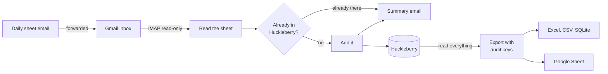

# MillieBeanCounter

Daycare daily sheets in, baby tracker entries out.

MillieBeanCounter reads the "Daily Sheet" emails that daycares send through Kaymbu (built
and tested with a Goddard School classroom's sheets) and logs every bottle, nap and
diaper in the Huckleberry baby tracker app. It also keeps a complete, auditable copy of
everything in Huckleberry as an Excel workbook, CSV files, a SQLite database and,
optionally, a Google Sheet, ready for pandas or SQL.

It runs in Docker, checks Gmail every 15 minutes, and emails you a short summary after
each sheet it logs.

## Why

The daycare's daily sheet lists every bottle, nap and diaper with times. Huckleberry is
where the rest of the day gets tracked. Copying one into the other by hand every
evening is slow, and it's easy to end up a few minutes or an ounce off.

The first version of this project drove the Huckleberry Android app in an emulator and
read the screen with OCR. This version skips all of that and talks to Huckleberry
directly through [py-huckleberry-api](https://github.com/Woyken/py-huckleberry-api),
an unofficial, reverse-engineered client. Shout out Woyken!

## How it works



1. Every 15 minutes it looks for new daily-sheet emails in a Gmail inbox, opened
   read-only. Only senders you allow and sheets for your child count.
2. It reads the bottles, diapers and naps from both the HTML and plain-text versions of
   the email and checks that the two agree. The date comes from the sheet itself, not
   from when the email was sent or forwarded.
3. It compares each entry with what Huckleberry already has, so nothing you entered by
   hand gets doubled.
4. It adds the rest, records everything in a local journal, and emails a summary.
5. After each import, and at least once a day, it reads everything in Huckleberry
   (every tracker, whoever entered it) and refreshes the data export.

Built with Python 3.14 in Docker, SQLite, openpyxl, the Google Sheets API and
py-huckleberry-api.

## Design choices

* **Never guess.** A line on the sheet in a wording it hasn't seen is reported in the
  summary, not logged.
* **Never overwrite.** It only adds entries. Nothing in Huckleberry is ever edited or
  deleted. When Huckleberry and the sheet disagree (wet vs. BM, 4 oz vs. 5 oz), the
  summary says so and a person decides.
* **Safe to run again.** Every email and entry is journaled. A diaper or bottle already
  in Huckleberry within 15 minutes of the sheet's time, or a nap that overlaps, counts
  as already there. Matching is one-to-one, so a single hand-entered diaper can't hide
  two daycare diapers. A crash partway through a sheet is retried without duplicates.
* **Auditable.** Every entry gets a permanent key. Every entry the agent adds can be
  traced back to the email it came from, and the export can be checked field by field
  against Huckleberry's own CSV export.
* **Private by default.** Passwords live only in a Docker volume, never in this folder.
  Gmail is opened read-only. The container runs as a non-root user with a read-only
  filesystem and no extra privileges. The tests use a made-up daily sheet.
* **Problems get reported once.** A problem is emailed at most once a day, and a failed
  data export never stops the sync itself.

## What it reads from the daily sheet

| On the sheet | In Huckleberry |
| --- | --- |
| "Offered 4.5 ounces of breastmilk and took 4 ounces at 10:30am" | A 4 oz breast milk bottle at 10:30 AM (formula and ml work too) |
| "Wet", "BM", "BM/Wet" or "Dry" diaper at a time | A pee, poo, both or dry diaper |
| "Napped from 12:10pm to 12:58pm (48 minutes)" | Sleep from 12:10 PM to 12:58 PM |

Check-in and check-out, meals and anything else on the sheet are left out, and so is a
bottle with nothing taken. Diapers get the note "From daycare", plus any teacher
comment. Bottles get it too with py-huckleberry-api 0.4.9 or newer.

## The summary email

```
Subject: Josie Mon Oct 12: 9 added to Huckleberry

From "Josephine's Daily Sheet for Monday, October 12th".

Josephine, Monday, October 12, 2026
 Added to Huckleberry (audit key in brackets):
   9:10 AM  Diaper  wet                                    [101226AD1]
   9:40 AM  Nap     until 10:15 AM (35 min)                [101226AN1]
  10:30 AM  Bottle  4 oz breast milk (offered 4.5 oz)      [101226AB1]
  11:50 AM  Diaper  wet + BM                               [101226AD2]
  12:10 PM  Nap     until 12:58 PM (48 min)                [101226AN2]
   1:35 PM  Diaper  wet                                    [101226AD3]
   2:15 PM  Bottle  3.5 oz breast milk (offered 4.5 oz)    [101226AB2]
   2:45 PM  Nap     until 3:25 PM (40 min)                 [101226AN3]
   3:40 PM  Diaper  BM                                     [101226AD4]
 Teacher comments:
  - 2:15 PM bottle: Took a little break halfway through.
 Day totals from the sheet:
  Bottles: 2, 7.5 oz total
  Naps: 3, 2h 3m total
  Diapers: 4 (2 wet, 1 wet + BM, 1 BM)
```

## The data

The export holds everything in Huckleberry: entries made in the app and the ones the
agent adds, for every tracker.

| Sheet | What's in it |
| --- | --- |
| All entries | One row per entry, every kind, with key, source, times, amount (also converted to ml), details and notes |
| Agent diapers, Agent naps, Agent bottles | Everything the agent added, with the daycare email it came from, when it was added, the teacher's comment, and whether it's still in Huckleberry |
| Diapers, Sleep, Bottles, Breastfeeding, Pumping, Medicine, Solids, Temperature, Growth, Activities, Potty | One sheet per kind, with that kind's own columns (pee and poo sizes, left and right minutes, pumped amounts, medicine names...) |
| Daily totals | Per day: bottles and ml, breastfeeds and minutes, wet and dirty diapers, sleep minutes, pumps and ml, medicine doses |
| Legend | What every key letter and column means |

**Audit keys** look like `102226AD1`: the date (MMDDYY), who entered it (**A**gent or
the **U**ser in the app), what it is, and a number for that day. So `102226AD1` is the
first diaper the agent logged for October 22, 2026, and `101226UB2` is the second bottle
entered in the app for October 12. Type letters: D diaper, N nap/sleep, B bottle, F
breastfeeding, P pumping, M medicine, S solids, T temperature, G growth, A activity,
O potty. Keys never change once given. An entry added later for an earlier day gets the
next free number.

**Formats.** `Get Data.command` saves the export to `Documents/Millie Data`:
`millie_data.xlsx` (every sheet), a `csv` folder (one file per sheet), `millie.db`
(SQLite) and `huckleberry_format.csv`. With a Google Sheet set up, the same tabs are
copied there after every refresh. Tabs you add to that sheet yourself are left alone.

```python
import pandas as pd

entries = pd.read_csv("csv/all_entries.csv", parse_dates=["start", "end"])
daily = pd.read_csv("csv/daily_totals.csv", parse_dates=["date"])
```

```sql
-- sqlite3 millie.db
SELECT date, wet_diapers, dirty_diapers, bottle_ml, breastfeeding_minutes
FROM daily_totals ORDER BY date DESC LIMIT 14;
```

**Checking it against Huckleberry.** Huckleberry's app can email you a CSV of your data.
Save it, double-click `Verify.command` and drag the file in. Every entry is lined up by
type and time and compared field by field. The full list of differences goes to
`verify_report.txt`. `huckleberry_format.csv` is the export laid out exactly like
Huckleberry's own file, so you can also compare the two yourself.

## Setup

### What you need

* A Mac with [Docker Desktop](https://www.docker.com/products/docker-desktop/). The
  `.command` files are plain bash scripts, so on Linux you can run them with `bash`.
* A Gmail inbox for the daily sheets. A separate Gmail account just for this is the
  tidy option: you forward the sheets to it, and the sync never touches your own inbox.
* 2-Step Verification on that Gmail account, so it can have an app password.
* A Huckleberry account that signs in with an email and password (see
  [Huckleberry login](#huckleberry-login)).

### 1. Make an app password for the sync's Gmail inbox

1. In a browser, sign in to the Gmail account the sheets will go to.
2. Turn on 2-Step Verification at <https://myaccount.google.com/security>.
3. Go to <https://myaccount.google.com/apppasswords>, type a name like `Millie sync`,
   click **Create**, and keep the 16-letter password handy for step 4.

### 2. Optional: auto-forward the daily sheets

Forwarding by hand works fine. To make it hands-off, do this in the Gmail account the
daycare emails, in a computer browser:

1. Gear icon > **See all settings** > **Forwarding and POP/IMAP** >
   **Add a forwarding address**, and enter the sync's inbox.
2. Google sends a confirmation to that inbox. Open it there and confirm.
3. Back in your Gmail, leave "Disable forwarding" selected (that setting would forward
   *everything*). Instead, open the search options (the sliders icon in the search bar),
   put `kaymbu.com` in **From** and `Daily Sheet` in **Subject**, click
   **Create filter**, tick **Forward it to**, pick the sync's inbox, and save.

### 3. Optional: a Google Sheet copy of the data

Skip this if the files on your Mac are enough. You can add it later by running
Setup.command again.

1. Go to <https://console.cloud.google.com> and create a project (any name, for example
   `Millie sync`). No billing is needed.
2. **APIs & Services > Library**, search for **Google Sheets API**, click **Enable**.
3. **IAM & Admin > Service Accounts > Create service account**. Name it
   `millie-sheets` and click **Done** (no roles needed). Copy its email address. It ends
   in `.iam.gserviceaccount.com`.
4. Click the new account > **Keys > Add key > Create new key > JSON**. A `.json` file
   downloads. Keep it private, because it works like the robot's password.
5. In Google Sheets, create a blank spreadsheet. Click **Share**, paste the service
   account's email, choose **Editor**, and share.
6. Share the sheet with anyone else who should see it.

If Google says key creation is blocked by an organization policy, you're probably signed
in to a work or school account. Use a personal Google account instead.

### 4. Run Setup.command

1. Open Docker Desktop and wait until it says the engine is running.
2. Double-click **Setup.command**. If macOS refuses to open it, right-click it, choose
   **Open**, then **Open** again.
3. It builds the Docker image (a few minutes the first time), then asks for:
   * the Gmail address the sheets go to, and the app password from step 1
   * the email and password you sign in to Huckleberry with
   * your child's name in Huckleberry and on the daycare sheet (they can differ, for
     example a nickname in the app), and the daycare's time zone
   * your own email, which it then suggests for the next two answers
   * who's allowed to send sheets (your address, plus `kaymbu.com` for auto-forwarding)
   * where to email summaries
   * the Google Sheet link and the `.json` key from step 3 (drag the file into the
     window), or `none`
4. It tests every connection, sends a test email, and shows exactly what it would add
   right now (nothing is written yet). Then you choose: start and add those, start but
   skip them, or don't start.

Run it again any time to change a setting. Your saved answers show up as suggestions.

## Everyday use

Nothing to do. It runs whenever Docker Desktop is open and catches up after the Mac has
been asleep (it looks back 7 days). In Docker Desktop, Settings > General >
"Start Docker Desktop when you sign in" keeps it going after a restart.

| Double-click | What it does |
| --- | --- |
| Status.command | What it has done lately, and any problem |
| Get Data.command | A fresh export of everything into Documents/Millie Data (opens the folder) |
| Verify.command | Checks the export against the CSV Huckleberry emails you |
| Run Now.command | Checks Gmail right now instead of waiting |
| Preview.command | Shows what it would add right now, without writing anything |
| Stop.command, Start.command | Pause and resume (nothing is lost) |
| Setup.command | Change settings, or install an updated version of this folder |

## Huckleberry login

The sync signs in with the email and password of the Huckleberry account your child is
on. If you sign in to Huckleberry with Google or Apple instead, there's no password for
the sync to use. You could try "Forgot password" on Huckleberry's email sign-in screen
to set one, but that isn't guaranteed to work for those accounts.

Because the connection is unofficial, an update on Huckleberry's side could break it.
You'd get a problem email. The usual fix is a newer py-huckleberry-api: change its
version in `requirements.txt` and run Setup.command again. (Versions 0.4.9 and newer
also save the "offered 4.5 oz" note on bottles.)

## If something seems off

* **Nothing showed up for a day:** run Status.command. If it saw no daily-sheet emails,
  look in the sync's inbox (including Spam). If the sheet is in Spam, mark it
  "Not spam", then run Run Now.command.
* **"Gmail didn't accept the login":** the app password was mistyped, or the account's
  password was changed (which cancels app passwords). Make a new app password and run
  Setup.command again.
* **"Huckleberry didn't accept that email and password":** see
  [Huckleberry login](#huckleberry-login).
* **"The Google Sheet isn't shared with ...":** share the sheet with that address as an
  Editor. **"Google Sheets API is turned off":** redo step 3.2.
* **A line "needs a look":** the daycare used a wording the sync hasn't seen. Add that
  entry by hand. If it keeps happening, the parser in `millie_sync/sheet.py` can learn
  the new wording.

## Advanced

Extra settings, from Terminal in this folder:

```bash
docker compose run --rm -T sync save-settings <<< "POLL_MINUTES=30"
```

| Setting | Default | Meaning |
| --- | --- | --- |
| POLL_MINUTES | 15 | How often to check Gmail |
| LOOKBACK_DAYS | 7 | How far back in Gmail to look |
| IMPORT_SINCE | (blank) | Ignore sheets dated before this day, e.g. 2026-10-20 |
| EXPORT_EVERY_HOURS | 24 | Refresh the data export at least this often |
| TIMEZONE | America/New_York | Time zone of the daycare's times |
| IMAP_FOLDER | INBOX | Gmail folder to read |

Other commands: `docker compose run --rm -T sync check` (test the connections),
`... sync export` (refresh the export and the Google Sheet), `... sync parse sheet.eml`
(read a saved email without logging in anywhere) and `docker compose logs -f sync`
(the live log).

## Privacy and security

* Gmail is opened read-only. Nothing is marked read, moved or deleted.
* Settings, passwords, the Google key and the journal live in the Docker volume
  `millie-sync-data`, not in this folder. Exports go to `Documents/Millie Data` and the
  Google Sheet.
* Summary emails are sent from the sync's own Gmail account to the addresses you chose.
* The container runs as a non-root user, with a read-only filesystem, no Linux
  capabilities and a memory limit. Only the code goes into the image (see
  `.dockerignore`).

## Tests

The test suite (81 tests) runs inside every Docker build, and the build stops if any
test fails.

* The parser tests use a made-up daily sheet in Kaymbu's exact email format, both as
  Gmail forwards it and as Kaymbu sends it, plus variations: formula, ml, every diaper
  kind, hour-long naps, new wordings, two sheets in one email.
* The Huckleberry tests run the real py-huckleberry-api code (0.4.8 and 0.4.9) against
  an in-memory stand-in for Huckleberry's database, so they check the exact documents
  that get written: times, time-zone offsets across daylight-saving changes, amounts,
  diaper kinds, nap lengths and notes. Duplicate handling, retries after a failed
  write, preview mode and audit keys are covered too.
* The export is checked by rebuilding a Huckleberry CSV export into that stand-in and
  exporting it again. The result has to match the original byte for byte. On a real
  1,220-entry Huckleberry export (not included here), every entry came back identical
  field by field. Only the order of entries logged in the same minute differed.

To run them yourself:

```bash
docker compose build   # runs the tests; the build stops if one fails
docker compose run --rm --entrypoint python sync -m unittest discover -s tests
```

With Python 3.14 and the packages in `requirements.txt` installed,
`python -m unittest discover -s tests` works outside Docker too.

## Project layout

| Path | What it does |
| --- | --- |
| `millie_sync/sheet.py` | Reads daily-sheet emails (HTML and plain text) into entries |
| `millie_sync/mailbox.py` | Gmail over IMAP (read-only), and sending the summaries |
| `millie_sync/huckleberry.py` | Huckleberry through py-huckleberry-api, and matching against what's already there |
| `millie_sync/sync.py` | One pass: new emails, read, match, add, journal, summary |
| `millie_sync/journal.py` | SQLite journal of emails, entries and audit keys |
| `millie_sync/history.py` | Reads everything in Huckleberry, every tracker |
| `millie_sync/keys.py` | Hands out the permanent audit keys |
| `millie_sync/export.py` | Builds the workbook and writes Excel, CSV, SQLite and Huckleberry's CSV layout |
| `millie_sync/verify.py` | Compares the export with Huckleberry's own CSV |
| `millie_sync/gsheets.py` | The optional Google Sheet copy |
| `millie_sync/data.py` | Runs an export |
| `millie_sync/service.py` | The always-on loop, status and health check |
| `millie_sync/config.py` | Settings and their checks |
| `millie_sync/__main__.py` | The command line the `.command` files use |
| `scripts/` and `*.command` | The Mac launchers |
| `tests/` | The test suite, with stand-ins for Gmail and Huckleberry's database |

## Credits

* [py-huckleberry-api](https://github.com/Woyken/py-huckleberry-api) by Woyken (MIT
  License) does the talking to Huckleberry.
* This project isn't affiliated with or endorsed by Huckleberry, The Goddard School or
  Kaymbu. Their names belong to their owners.
